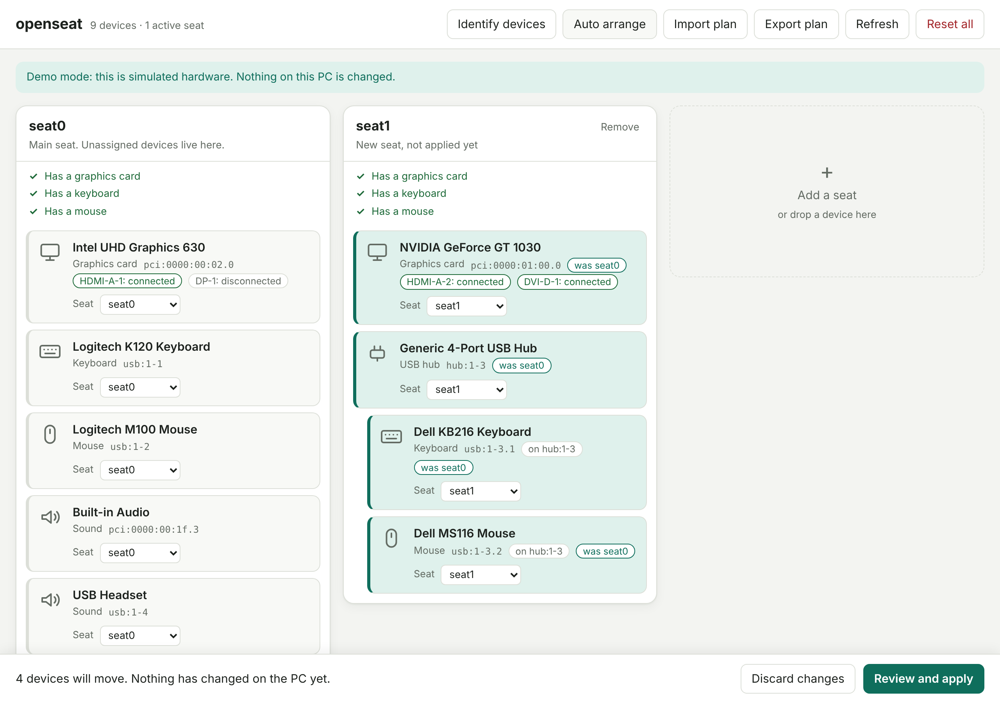
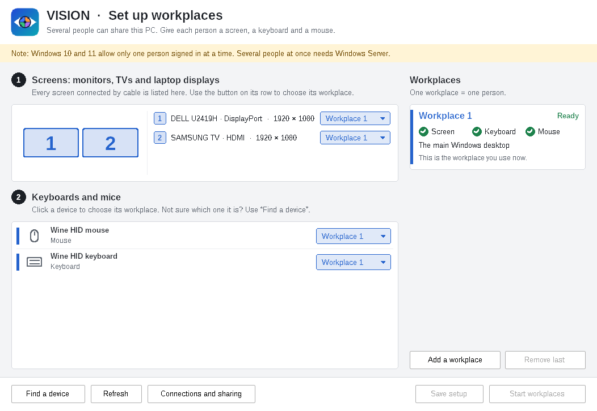

# os-aster / openseat

Open-source multiseat: several people use **one PC** at the same time, each
with their own monitor, keyboard, mouse and sound.

This is an original project written from scratch. It is not affiliated with,
and contains no code from, ASTER or IBIK.

| Part | Status |
| --- | --- |
| **Linux** (`openseat`) | Working command-line tool and graphical interface. Tested against simulated hardware; not yet run on a real multi-GPU PC. |
| **Windows** (`windows/openseat/`, `windows/installer/`) | **VISION**, with an installer: sets up and runs extra workplaces. Needs Windows Server and the free Interception driver. Tested under Wine, **not yet on a real Windows PC**. |

## Linux

Linux already supports multiseat through systemd-logind. `openseat` makes it
easy: it finds your hardware, suggests a split, and applies it.

### What you need

- A Linux system with systemd, and Python 3.11 or newer.
- **One graphics card per seat.** Linux cannot split two monitors on the same
  card between two users. A second card (PCI or USB) is enough.
- A keyboard and mouse per seat.
- A display manager with multiseat support (GDM and LightDM are known to work).

### Install

```bash
pip install .
```

### Graphical interface

```bash
openseat gui
```

This opens the seat manager in your web browser. Drag devices between seats
(or use the "Seat" menu on each device), then press **Review and apply**.



- **Identify devices**: press a key or move a mouse and the device lights up.
  Needs permission to read input devices (`sudo openseat gui`, or be in the
  `input` group).
- **Auto arrange**: suggests one seat per graphics card.
- **Import / Export plan**: load or save the layout as a plan file.
- **Reset all**: every device back to `seat0`.

Nothing changes on the PC until you apply. When you apply, your system may
ask for an administrator password.

To try the interface without the right hardware (it works on any computer
with Python, including Windows and macOS):

```bash
openseat gui --demo
```

The GUI is a small local server. It listens only on this computer
(`127.0.0.1`) and only accepts requests carrying the secret code in the
address it prints, so keep that address private while it is running.

### Command line

See your hardware:

```bash
openseat list
```

```
SEAT   KIND      ID                NAME
seat0  gpu       pci:0000:00:02.0  PCI 8086:3e92
                                     HDMI-A-1: connected
seat0  gpu       pci:0000:01:00.0  PCI 10de:1c82
seat0  keyboard  usb:1-1           Acme Keyboard
seat0  keyboard  usb:1-3.1         Second Keyboard  (on hub:1-3)
seat0  usb-hub   hub:1-3           4-Port Hub
```

Find out which keyboard or mouse is which (press a key on it):

```bash
sudo openseat identify
```

Get a suggested plan, then edit it if needed:

```bash
openseat auto > seats.toml
```

Preview and apply it:

```bash
sudo openseat apply --dry-run seats.toml
```

```bash
sudo openseat apply seats.toml
```

A login screen appears on each seat's monitor. The assignment is permanent
(it survives reboots) until you change it.

### All commands

| Command | What it does |
| --- | --- |
| `openseat list [--all] [--json]` | List graphics cards, keyboards, mice, sound cards, USB hubs |
| `openseat seats` | Show each seat and its devices |
| `openseat identify` | Show which keyboard/mouse you are touching |
| `openseat auto` | Print a suggested seat plan |
| `openseat apply PLAN [--reset-others] [--strict]` | Apply a plan file |
| `openseat attach SEAT ID...` | Assign devices to a seat by hand |
| `openseat detach ID...` | Return devices to `seat0` |
| `openseat reset` | Undo everything: all devices back to `seat0` |
| `openseat doctor` | Check the PC is ready for multiseat |
| `openseat gui [--demo] [--port N] [--no-browser]` | Open the graphical interface |

Commands that change things accept `-n` / `--dry-run`.

### Plan file

```toml
[seats.seat0]
devices = ["pci:0000:00:02.0", "usb:1-1", "usb:1-2"]

[seats.seat1]
devices = ["pci:0000:01:00.0", "hub:1-3"]
```

- Seat names must start with `seat`.
- Assigning a USB hub (`hub:...`) moves everything plugged into it, including
  devices plugged in later. This is the easiest way to build a workstation.
- USB ids are port-based: `usb:1-3.1` means "whatever is in that port".

### Tests

```bash
python3 -m unittest
```

## Windows: VISION


**VISION** turns one Windows PC into several workplaces. Each person gets
their own screen, keyboard and mouse. Install it with
[`docs/download/VISION-Setup.exe`](docs/download/VISION-Setup.exe): the setup adds
VISION to the Start menu and desktop and can be removed again from Windows'
"Apps" list. (`docs/download/VISION.exe` is the same program without an installer.)



The website for VISION is in [`docs/`](docs/index.html): one page with the
download button, features, requirements and questions. It is plain HTML with
no build step, so it can be put online with GitHub Pages (Settings, Pages,
"Deploy from a branch", folder `/docs`) or any other web host.

### Installing Windows Server automatically

[`docs/download/VISION-Server-USB-kit.zip`](docs/download/VISION-Server-USB-kit.zip)
holds `autounattend.xml` and VISION's setup. Copied onto a Windows Server 2022
USB stick (made with Rufus), it installs Windows Server by itself, then
installs and opens VISION. You only choose the disk. It erases that disk, so
back up first. See `windows/server-usb/README.txt`.

### What you need

- **Windows Server 2016 or newer.** Windows 10 and 11 allow only one person
  signed in at a time, so they cannot run extra workplaces. Windows Server
  allows two extra people without extra licences; more need Remote Desktop
  Services licences.
- **The Interception input driver** (free for non-commercial use). VISION
  offers to download and install it the first time; the PC must restart once.
- One screen per workplace, plus a keyboard and mouse for each. Up to
  **10 workplaces** (the input driver handles at most 10 keyboards and 10
  mice). The PC needs a video output for every screen, for example several
  graphics cards or USB display adapters.

### How to use it

1. Run `VISION.exe`. Every connected monitor, TV or laptop display appears
   under **Screens**, with its name and plug type (HDMI, VGA, ...). A screen
   plugged in later appears by itself. Each screen has its own row in the
   screen list with a button to choose its workplace. A screen that is
   connected but switched off, or only shows a copy of another screen, is
   listed with a **Turn on** button (the same as Win+P, Extend).
2. Every screen gets a workplace of its own automatically: screen 1 is
   Workplace 1, screen 2 is Workplace 2, and so on. A workplace never has two
   screens; choosing a workplace that already has a screen swaps the two.
3. Optionally click each keyboard and mouse and choose its workplace. If you
   skip this, VISION asks at start: press a key and click on each
   workplace's screen.
4. Press **Start workplaces** and allow administrator permission.

There is no account to create: VISION makes a hidden Windows account for
each workplace and signs it in by itself.

A small window shows each workplace's state. **Stop** (or Ctrl+Alt+Shift+S on
workplace 1's keyboard) ends the extra workplaces; their programs keep running
and come back at the next start.

### Connections and sharing

Workplaces are separate: programs, files and screen content of one are not
visible in another. The **Connections and sharing** panel is the one place
that decides what each workplace may do:

| Option | Meaning |
| --- | --- |
| Switched on | The workplace starts with Start workplaces |
| Copy and paste | Text can be copied between it and Workplace 1 |
| Shared folder | It may open `C:\Users\Public\VISION Shared` |
| Sound | It may play sound on the PC's speakers |

Anything not ticked stays private. Changes apply the next time the workplaces
start. Note: other drives (such as `D:`) follow normal Windows permissions, so
keep private files inside your own user folder.

### Shared-Windows mode (the default)

All workplaces use this PC's one Windows, and VISION keeps them apart. The
installer sets VISION to start with Windows, so after the workplaces are set
up once (screen, keyboard and mouse for each, then **Save setup**) this runs by
itself at every start. Changes saved in the setup window are used at once.

- a program window belongs to the workplace whose keyboard or mouse was used
  last when it opened, and appears on that workplace's screen;
- a window dragged onto another workplace's screen is moved back;
- the pointer stays on the screen of the workplace whose mouse moved last;
- typing on a workplace's keyboard brings that workplace's window to the front;
- each screen's taskbar shows only its own windows.

People share one keyboard focus and one pointer, so they take turns; the first
key press after switching can reach the previous window.

On Windows Server, **Start workplaces** (and the automatic start, via a
scheduled task the setup creates) instead gives every workplace its own
Windows sign-in on this PC, so each one works like a separate PC at the same
time (the mode described below).

### How it works

- Each extra workplace is a Remote Desktop session on this same PC, shown full
  screen on its monitor.
- The Interception driver tells VISION which keyboard or mouse every input
  comes from. Workplace 1's input passes through unchanged. Other workplaces'
  input is sent to a small VISION helper inside that workplace's session.
- Workplace 1's pointer is kept on its own screens, and the other workplaces'
  windows cannot be typed into from workplace 1.
- If VISION stops or crashes, all input goes back to the main desktop.

### Limits

- Sound from every workplace plays on the PC's default speakers.
- If workplace 1 locks the PC (Win+L), the other screens are hidden until it
  is unlocked.
- 3D-heavy programs and games run slower in the extra workplaces.
- VISION.exe is not code-signed, so Windows SmartScreen warns the first time.

### Testing status

Tested under Wine on Linux: the setup window, the account dialog, the
sharing panel, the press-a-key prompt and the whole input routing path, with a stand-in for the
Interception driver (`windows/openseat/test/run-wine-test.sh`). **Not yet
tested on a real Windows Server PC.** The workplace sign-in, the automatic
hidden accounts, the shared-folder permissions, the screen names and the
driver installation can only be checked there.

Build the program and the installer yourself (needs MinGW-w64 and NSIS):

```bash
windows/installer/build-installer.sh
```

## License

MIT
